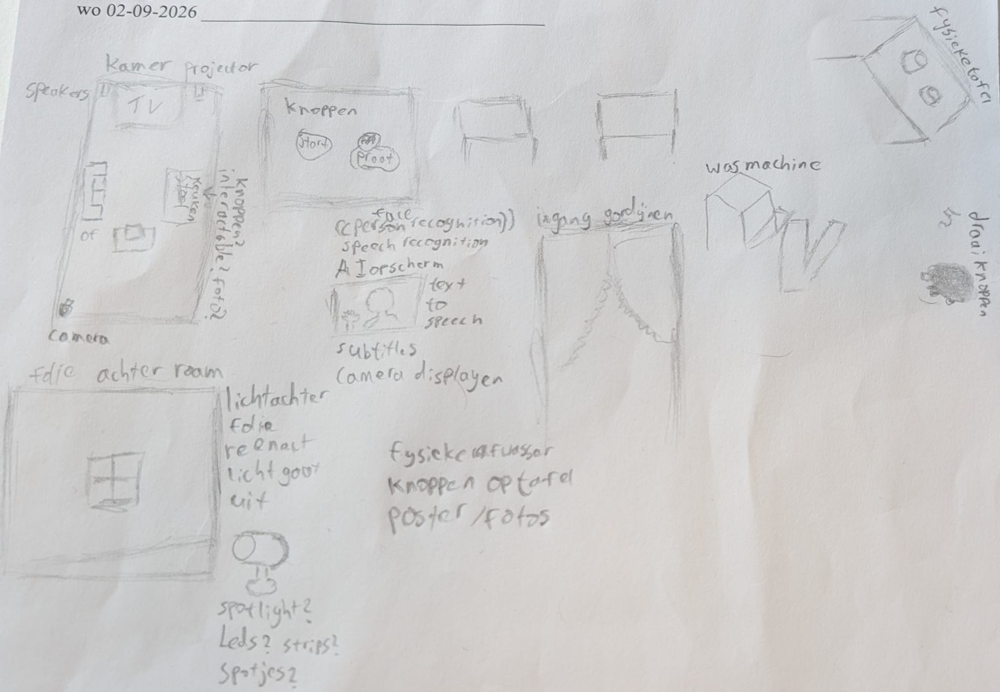
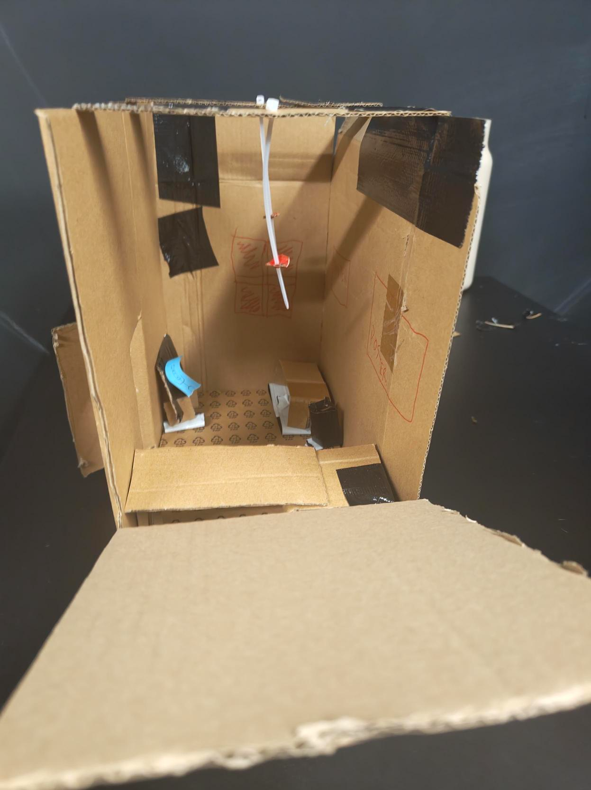
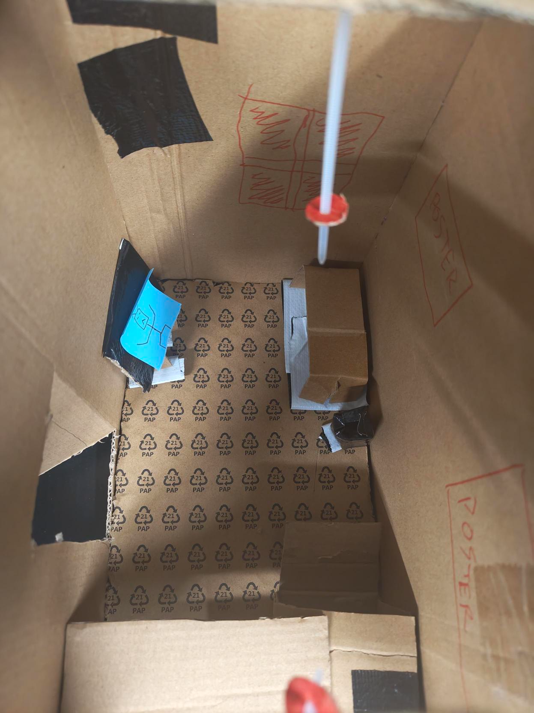
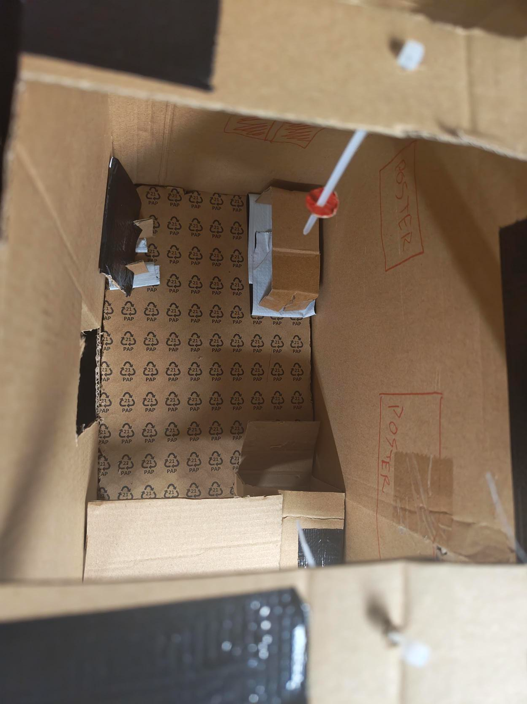
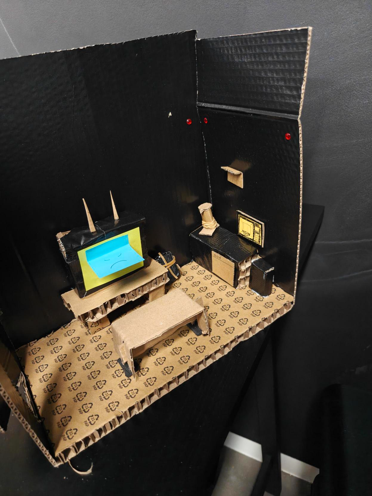
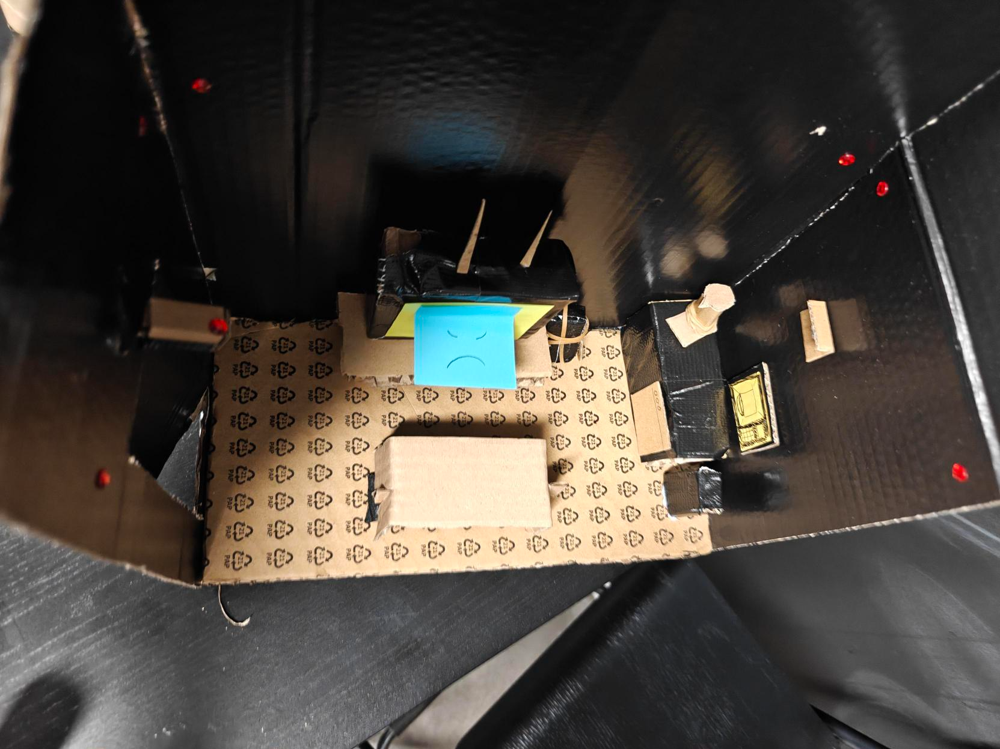
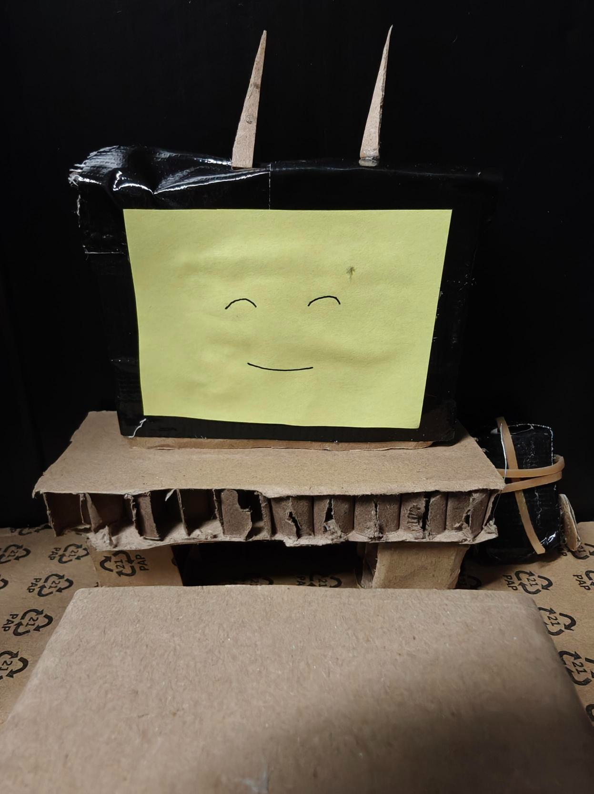
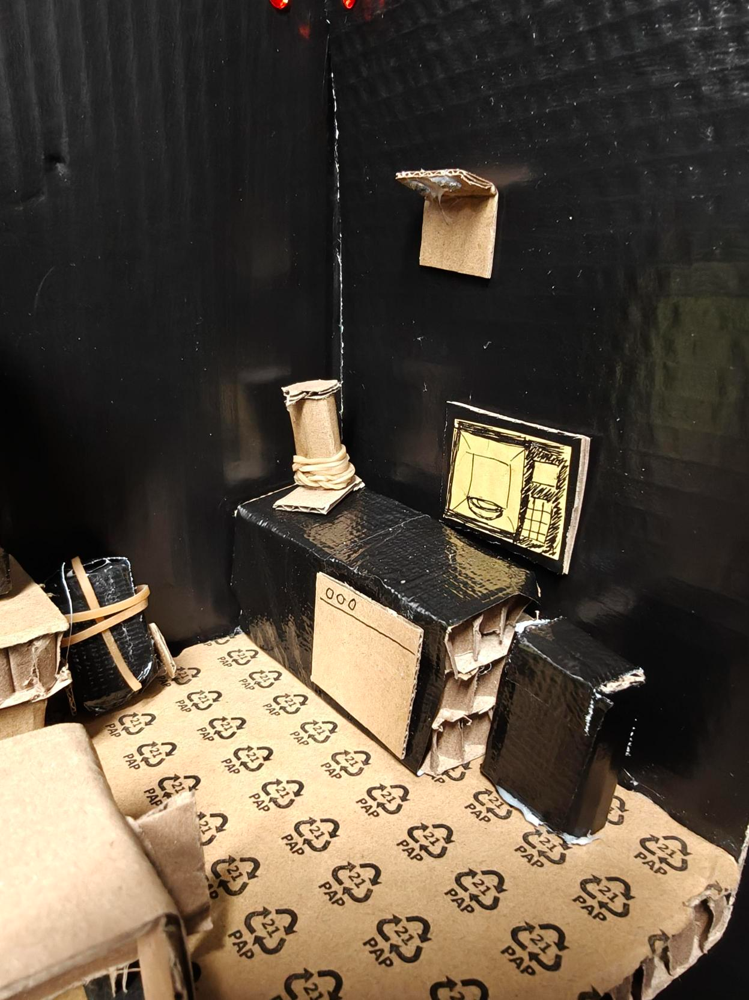
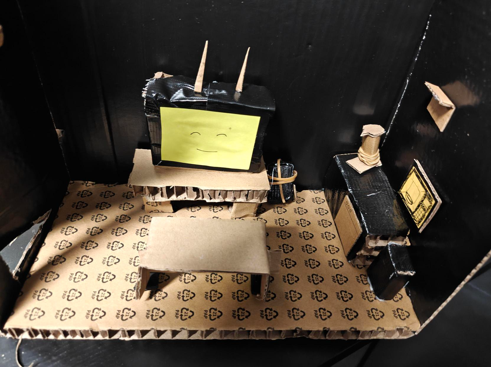

# Punishing Home
### Blog voor Punishing Home 
Als project heb ik Punishing Home van Thinker gekregen. Punishing Home is een smart home dat gebaseerd op het gedrag van de bewoner reageert met sancties zoals het vergrendelen of sluiten van deuren of toegang blokkeren van apparaten. 

## Inhoudsopgave
1. [Oorspronkelijk Idee](#1-oorspronkelijk-idee "Oorspronkelijk Idee")
2. [Mijn rol](#2-mijn-rol "Mijn Rol")
3. [Experimenten en Prototyping](#3-experimenten-en-prototyping "Experimenten en Prototyping")
4. [Ontwerp- en Technische Keuzes](#4-ontwerp--en-technische-keuzes "Ontwerp- en Technische Keuzes")
5. [Problemen](#5-problemen "Problemen")
6. [Belangrijke Iteraties](#6-belangrijke-iteraties "Belangrijke Iteraties")
7. [Het Eindresultaat](#7-het-eindresultaat "Het Eindresultaat")
8. [Geleerd](#8-geleerd "Geleerd")
9. [Volgende Iteraties](#9-volgende-iteraties "Volgende Iteraties")

## 1. Oorspronkelijk Idee

### Sprint 1

Als eerst begonnen we allemaal met het maken van schetsen en ideeën op doen van wat we allemaal in het smart home wouden hebben en daarna konden discussiëren wat we wouden toevoegen aan ons Smart Home. 

### Sprint 2

Het idee voor sprint twee was om een LLM te gebruiekn om de AI te laten praten met de gebruiker. Uiteindelijk hebben we besloten om TTS te gebruiken om de AI te laten praten en het praten met de AI laten wachten. 

## 2. Mijn rol

Mijn rol binnen het project is de AI werkend krijgen en zorgen dat er AI plaatsvind binnen het project. Ideeën voor AI binnen Punishing Home is TTS, STT, Object recognition en een LLM. TTS en STT voor het praten met de AI en gesprekken kunnen voeren met het huis. Object recognition om te herkennen wanneer de bewoner thuis is en of alle klusjes gedaan zijn die gedaan moeten worden. Een LLM om antwoorden te geven op de antwoorden van de gebruiker.

## 3. Experimenten en Prototyping

Eerste prototypes die we nu hebben gemaakt zijn twee kartonnen huizen van hoe we willen dat het smart home eruit komt te zien. 

## 4. Ontwerp- en technische keuzes

### Sprint 1

Na het vergelijken van alle schetsen die we individueel hebben gemaakt samen met feedback van onze product owner, zijn we eruit gekomen om een 2 bij 1 kamer te maken met daarin een TV (die de AI manifesteert), speakers en een (interactieve) vaatwasmachine. Daarnaast ook diverse LED lichten, bank/stoel/zitplek, en wat andere apparatuur die we goedkoop kunnen verkrijgen.

### Sprint 2

Besloten om eerst alleen de een LLM het script te laten genereren en de STT later toe te voegen. De reden hiervoor is dat het script de basis is van het huis en dat we eerst een goed script moeten hebben voordat we de AI kunnen laten praten met de gebruiker. Ik heb ook gekozen voor een lichte versie van de LLM te gebruiken omdat deze sneller is en minder resources gebruikt, omdat we ook van plan zijn om de AI op een esp/pico te laten draaien. Kijken of het wel mogelijk is om zo een lichte AI te draaien.

## 5. Problemen

### Sprint 1

Ik kwam problemen tegen bij het brainstormen over wat er allemaal in het smart home kan en mogelijk is. Meeste van mijn ideeën waren te ambitieus en te moeilijk om binnen de hoeveelheid kennis en tijd voor elkaar te krijgen. Daarom ben ik voor wat simpelere ideeën gegaan. In het begin wou ik echt een interactieve wasmachine/wastafel waar de bewoner dan echt bezig was. Onze product owner wees erop dat het een ervaring moest zijn en niet een escape room. Daarom was dat idee geschapt.

### Sprint 2

Tijdens sprint 2 wist ik niet hoe ik als eerst de LLM samen kon laten werken met TTS. Ik heb toen besloten om eerst alleen de LLM te gebruiken om het script te genereren en daarna pas TTS toe te voegen. Voor het verbinden had ik de stof gebruikt uit een van de eerste lessen die we hebben gekregen. Waarbij ik ollama heb gebruikt om de LLM te laten draaien en de output van de LLM te gebruiken als input voor TTS. Uiteindelijk heb ik het werkend gekregen en kan ik nu een script genereren met de LLM en dit script laten uitspreken door TTS met piper-tts. In folder docs is er een m4a file te vinden van het script dat gegenereerd is door de LLM en uitgesproken door piper-tts. Elke keer dat de applicatie wordt opgestart en een script wordt gegenereerd, wordt er een nieuw script aangemaakt.

## 6. Belangrijke Iteraties

### Sprint 1

De belangrijkste iteraties zijn de schetsen en de kartonnen huizen. De huizen konden niet gemaakt worden zonder de schetsen/dan hadden we niet geweten wat in het huis kon/ging.

### Sprint 2

Belangrijkste iteraties zijn het script dat gegenereerd is door de LLM, door TTS laten uitspreken, en daarna het laten uitspreken samen met een persona wat dat mond beweegt wanneer de AI praat. Die wordt dat op de TV geprojecteerd. Die dan laten samen met een ventilator die aan gaat wanneer de AI praat en LEDs die roder worden naar mate de AI bozer wordt. In de docs folder staat er 1st version.mp4 wat een van de eerste versies laat zien van hoe het eruit ziet wanneer de AI praat. Na een guerilla test bleek dat een vrouwelijke stem geen goed idee omdat het bepaalde emoties opwekte binnen onze tester. Daarom hebben we gekozen om espeak te gebruiken, een andere tts engine. Daarna gebruik gemaakt van een AnalyserNode om de output van de TTS te analyseren en de mond van de persona te laten bewegen op basis van de output van de TTS.

## 7. Het Eindresultaat

### Sprint 1

Eind van deze sprint zijn twee kartonnnen huizen gemaakt die we kunnen gebruiken voor de volgende sprint. 

### Sprint 2

Eind van deze sprint is een script dat gegenereerd is door de LLM en dit script wordt uitgesproken door TTS. Ook is er een persona die op de TV geprojecteerd wordt en die mond beweegt wanneer de AI praat. Het laat ook een het beeld zien van de kamer waar de gebruiker zich bevindt. Een ventilator die aan gaat wat laat zien dat de AI in controle van het huis is. LEDs die roder worden naar mate de AI bozer wordt.

## 8. Geleerd

### Sprint 1

In deze sprint heb ik geleerd dat het belangrijk is om goed te brainstormen en ideeën te bespreken met de product owner. Ook heb ik geleerd dat het belangrijk is om realistisch te zijn over wat er mogelijk is binnen de tijd en kennis die we hebben.

### Sprint 2

In deze sprint heb ik geleerd hoe ik een LLM kan gebruiken om een script te genereren en dit script kan laten uitspreken door TTS. Ook heb ik geleerd dat een lichte AI niet altijd de beste keuze is, omdat het minder resources gebruikt en sneller is, maar het kan ook minder goed presteren dan een zwaardere AI. Ook heb ik geleerd dat het belangrijk is om te testen en te experimenteren met verschillende AI's om te zien welke het beste werkt voor ons project. Met behulp van de feedback die we hebben gekregen op society 5.0 hebben we een richtlijn om op te werken.

## 9. Volgende Iteraties

### Sprint 1

In de volgende sprints gaan we de kartonnen huizen gebruiken als richtlijnen voor het maken van een echt smart home. We gaan kijken naar de mogelijkheden van de AI en hoe we deze kunnen implementeren in het huis. 

### Sprint 2

In de volgende sprints gaan we kijken naar de mogelijkheden van de AI en hoe we deze kunnen implementeren in het huis. We gaan ook kijken naar de mogelijkheden van STT en hoe we deze kunnen implementeren in het huis. Ook gaan we kijken naar de mogelijkheden van object recognition en hoe we deze kunnen implementeren in het huis. Meer apparaten aansluiten aan het smart home. 